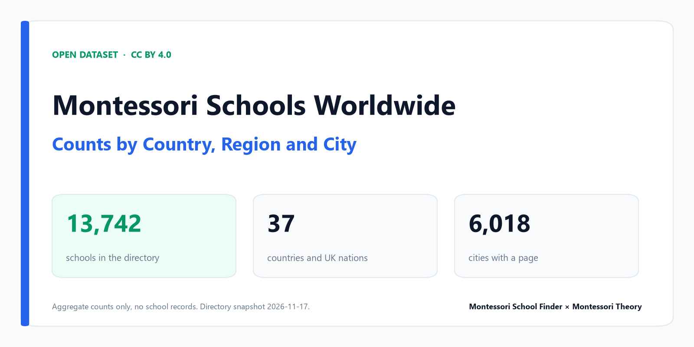
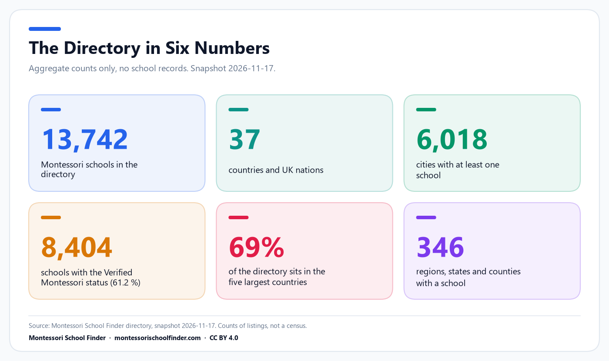
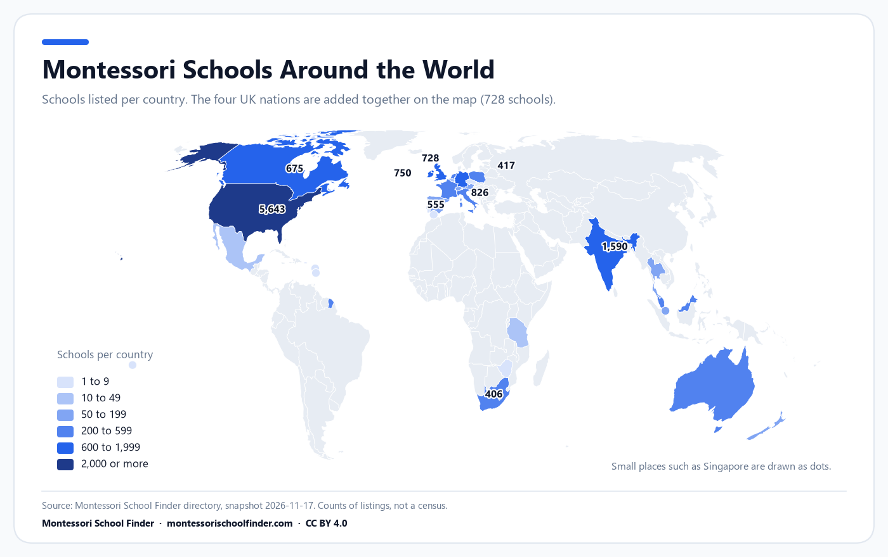
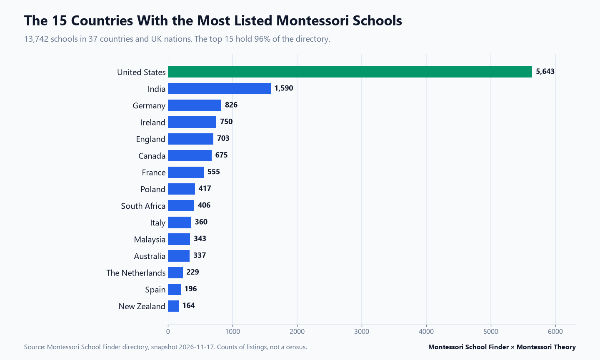
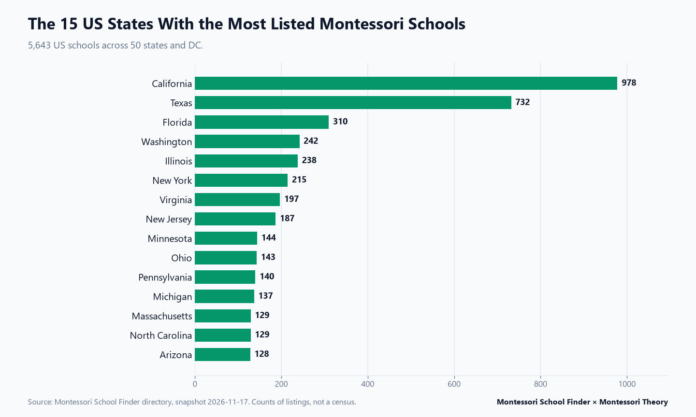
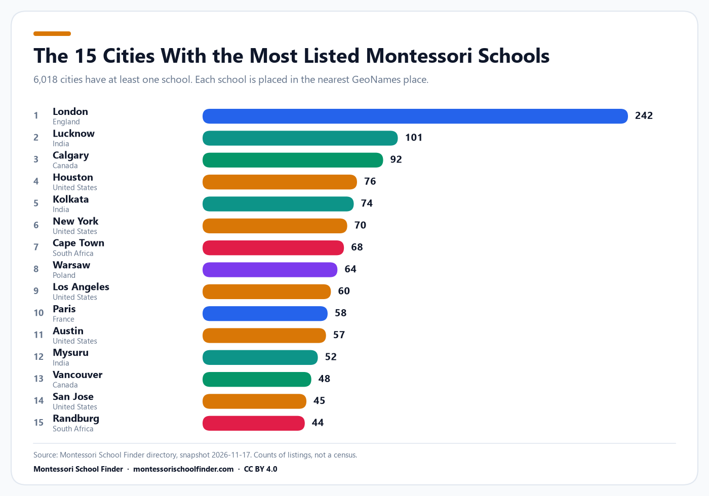

# Montessori Schools Worldwide: Counts by Country, Region and City

[](https://creativecommons.org/licenses/by/4.0/)



**English first, version française plus bas, resumen en español al final.**

## How Many Montessori Schools Are There, and Where?

This open dataset counts the Montessori schools listed in the [Montessori School Finder](https://www.montessorischoolfinder.com/) directory. It answers questions such as "how many Montessori schools are there", "Montessori schools by country" and "Montessori schools in [country]", down to the region and the city.

It holds **aggregate counts only**. There are no school names, addresses, phone numbers, coordinates, ratings, reviews, websites or school ids. Every place has a `msf_url` column that opens its page on Montessori School Finder, where the schools themselves are listed. It is published by Montessori School Finder.

The counts are a **directory snapshot dated 2026-11-17**, not a census. Please read the sections on coverage before drawing conclusions.

### The Headline Numbers

|  |  |
|---|---|
| Schools in the directory | 13,742 |
| Countries and UK nations | 37 (England, Scotland, Wales and Northern Ireland count as four) |
| Regions with at least one school | 346 |
| Cities with at least one school | 6,018 |
| Schools with the Verified Montessori status | 8,404 (61.2 %) |
| Largest countries | United States 5,643, India 1,590, Germany 826, Ireland 750, England 703 |
| Share of the five largest countries | 69 % of the directory |
| Largest US states | California 978, Texas 732, Florida 310, Washington 242, Illinois 238 |
| Largest cities | London 242, Lucknow 101, Calgary 92, Houston 76, Kolkata 74 |
| Cities with a single school | 3,841 of 6,018 (64 %) |
| US schools by type | 167 public charter, 128 public district, 5,348 private or not classified |











### Files

| file | content |
|---|---|
| `data/by_country.csv` | 37 rows. Schools, cities, regions, verified count and share, and the country page |
| `data/by_region.csv` | 346 rows. Schools and cities per region, with the region page |
| `data/by_city.csv` | 6,018 rows. Schools per city, with the city page |
| `data/programs_by_country.csv` | Program levels by country. 23 countries with 10 or more schools, one combined row for the 14 smaller ones, and a world total |
| `data/us_public_private_split.csv` | 1 row. US public charter, public district and other schools |
| `data/summary.csv` | Headline figures and the sum checks |
| `data_dictionary.csv` | Every column of every file |
| `scripts/build_counts.mjs` | Rebuilds the CSV files from the directory database (Node 24) |
| `scripts/make_images.py` | Rebuilds the cover and the charts |
| `scripts/make_notebook.py` | Rebuilds and runs the starter notebook |
| `notebooks/starter.ipynb` | A starter notebook, already executed |

Only places that have a page on Montessori School Finder appear. Every country, region and city in the files has one.

### Columns

**by_country.csv**

| column | description |
|---|---|
| `country_code`, `iso2`, `country` | Country code, real ISO 2-letter code (GB for the four UK nations) and name |
| `schools` | Schools listed in the directory |
| `share_of_directory_pct` | Share of all listed schools |
| `cities_with_schools`, `regions_with_schools` | Cities and regions with at least one school |
| `verified_schools`, `verified_share_pct` | Schools with the Verified Montessori status. Blank when the country has fewer than 10 schools |
| `msf_url` | Country page on Montessori School Finder |
| `directory_date` | Date of the snapshot |

**by_region.csv** has `country_code`, `country`, `region_code`, `region`, `schools`, `cities_with_schools`, `msf_url` and `directory_date`. **by_city.csv** has `country_code`, `country`, `region`, `city`, `geonames_id`, `schools`, `msf_url` and `directory_date`. The other files are described column by column in `data_dictionary.csv`.

### Load It

```python
import pandas as pd

base = "https://raw.githubusercontent.com/montessoritheory/montessori-schools-worldwide-counts/main/data"
country = pd.read_csv(f"{base}/by_country.csv")
country[["country", "schools", "verified_share_pct", "msf_url"]].head(10)

city = pd.read_csv(f"{base}/by_city.csv")
city[city.country == "Ireland"].sort_values("schools", ascending=False).head()
```

### Reach Any Place Page

Each row carries the address of its page on Montessori School Finder in `msf_url`. The pattern is simple.

| level | address pattern | example |
|---|---|---|
| Country | `/locations/{country}/` | `https://www.montessorischoolfinder.com/locations/ireland/` |
| Region | `/locations/{country}/{region}/` | `https://www.montessorischoolfinder.com/locations/ireland/dublin/` |
| City | `/locations/{country}/{region}/{city}/` | `https://www.montessorischoolfinder.com/locations/united-states/texas/houston/` |

These pages are where you find the individual schools, so this is the answer to "Montessori schools near me" for a given city. The counts in this dataset match the numbers shown on those pages on the snapshot date.

## What the Directory Is

[Montessori School Finder](https://www.montessorischoolfinder.com/) is a worldwide directory of schools that call themselves Montessori, from nurseries and daycares to elementary and secondary schools, in English. Every school sits in exactly one city, in one region, in one country.

Most school listings were collected from online map listings, mainly Google Maps, and completed with official sources where one exists, for example the US National Center for Education Statistics (NCES) school files. Because the individual listings are largely Google-derived, **they are not republished here and are never published as open data**. This package keeps to counts, which describe the directory without reproducing any record.

### How Schools Are Identified

A school is listed when the evidence that it is Montessori reaches a minimum score. The signals are free and public.

- An official record that names the school as Montessori, such as the NCES Private School Survey or the NCES Common Core of Data for US schools.
- The school's own website mentions Montessori.
- The school name contains "Montessori" or Montessori's own term for her schools, for example "Children's House".
- The Google category is "Montessori school", or the website address contains "montessori".
- Known non-Montessori chains and permanently closed schools are removed.

A school is marked **Verified Montessori** when an official record confirms it, or when its own website mentions Montessori together with other signals. The other listed schools are "likely" Montessori, mostly on the strength of their name. `verified_schools` counts the first group. It is not an accreditation. Membership in AMS, AMI or any other association is a different thing and is not counted here.

### Coverage Bias

The counts show what the directory found, not how many Montessori schools exist. Coverage is uneven.

- It is strongest where official, public school files exist or where the directory has been checked most closely. The United States, Germany, Ireland, England and Canada are all in the top six by count. The verified share is highest in the United States (79 %), England (73 %), Germany (72 %) and Canada (69 %).
- It is weaker in many other countries. Several countries have fewer than 10 listed schools, and 14 of the 37 countries do.
- A large count does not always mean good coverage. India has 1,590 listings but only 19 % are verified, so many listings rest on a name only.
- The directory lists individual campuses, including nurseries and preschools that use the Montessori name. National organizations count schools in other ways, so the two kinds of figure are not comparable.
- Countries are the ones present in the directory. A country that is missing has no listed school, which does not prove it has none.
- Scotland (10), Wales (9) and Northern Ireland (6) are separate rows from England (703). Puerto Rico (1) is separate from the United States.

### Counts, Not a Census

The files are a snapshot taken on **2026-11-17**. They are built from the same database as the live site. Google-derived data in the directory dates from January 2025, the NCES Private School Survey is the 2023-24 wave, and the geographic places come from GeoNames of 2026-11-10. Schools open and close all the time, so a later version of the directory will give different counts.

### Program Levels

Each listed school can carry several program levels, for example preschool and kindergarten. In `programs_by_country.csv` every level is counted separately, so the columns do not add up to `schools`. In the whole directory, **6,842 schools list a preschool program**, 2,549 kindergarten, 2,292 daycare, 2,230 elementary, 1,064 middle school, 386 high school, 323 infant and 26 toddler. For **4,571 schools (33 %) no program level is known**. Countries with fewer than 10 schools are combined in one `OTHER` row, so no cell describes one single school.

### US Public and Private

In `us_public_private_split.csv`, 167 US listings are public charter schools and 128 are public district schools, according to official US school records. The other 5,348 are mostly private schools. A school that could not be matched to an official record is counted there too, so the public count is a floor. One more public school sits in Puerto Rico and is not in this file.

## How It Was Built

`scripts/build_counts.mjs` opens the Montessori School Finder publish database in read-only mode with the built-in `node:sqlite` module and writes the CSV files. Nothing is estimated. Counts come from the school table, grouped by country, region and city. `scripts/make_images.py` draws the cover and the charts from the CSV files.

```
node --no-warnings scripts/build_counts.mjs path/to/msf.sqlite
python scripts/make_images.py
python scripts/make_notebook.py
```

The database itself is not part of this package.

### Checked

- Cities add up to regions, regions add up to countries, and countries add up to the directory total of **13,742**. The script stops if they do not.
- Every country, region and city count was compared with the figures stored for the live site pages (0 differences in 37 countries, 346 regions and 6,018 cities).
- Five country pages of the built site were checked by hand against `by_country.csv` (United States 5,643 schools in 2,555 cities, India 1,590 in 570, Ireland 750 in 236, England 703 in 288, Germany 826 in 16 states).

### Read With Care

- **No identification of single schools.** City counts of 1 mean one school exists in that city, nothing more. Verified shares and program counts are left out for countries with fewer than 10 schools.
- **Verified is not accredited.** It means evidence of Montessori practice in the listing, not AMS, AMI or any other accreditation.
- **City borders are not official.** Each school is placed in the nearest GeoNames place within 25 km, with a preference for the locality named in its address. Suburbs can therefore appear as their own city.
- **UK nations are separate countries here.** Add the four rows (728 schools) to get a United Kingdom total.
- **Not a growth series.** There is one snapshot, so there is no trend.

## Further Reading

A different and independent count of Montessori schools comes from the 2022 Global Montessori Census. It estimates schools from national and regional Montessori organizations. It is published under CC BY-NC 4.0, a non-commercial license, so none of its numbers are copied into this CC BY dataset. Read it at the source.

- Debs, M. C., de Brouwer, J., Murray, A. K., Lawrence, L., Tyne, M., and von der Wehl, C. (2022). *Global Diffusion of Montessori Schools: A Report From the 2022 Global Montessori Census.* Journal of Montessori Research, 8(2), 1-15. [DOI 10.17161/jomr.v8i2.18675](https://journals.ku.edu/jmr/article/view/18675)

The [Montessori school statistics page](https://www.montessorischoolfinder.com/montessori-school-statistics/) on Montessori School Finder puts the census next to the directory counts, country by country, with the same caution about what each one measures.

## Image Credits

Cover photo by Anil Sharma on [Pexels](https://www.pexels.com/photo/40282969/), Pexels License. World outlines in the map from [Natural Earth](https://www.naturalearthdata.com/), public domain. Charts by Montessori School Finder.

## License and Citation

**[CC BY 4.0](https://creativecommons.org/licenses/by/4.0/)**. Use it, share it and adapt it, commercially or not, and credit **Montessori School Finder** with a link to **[montessorischoolfinder.com](https://www.montessorischoolfinder.com/)**.

```bibtex
@misc{msf_montessori_schools_worldwide_counts_2026,
  title  = {Montessori Schools Worldwide: Counts by Country, Region and City},
  author = {{Montessori School Finder}},
  year   = {2026},
  url    = {https://github.com/montessoritheory/montessori-schools-worldwide-counts},
  note   = {Dataset, version 1.0, directory snapshot of 2026-11-17}
}
```

---

## Version Française

### Écoles Montessori dans le monde, nombres par pays, région et ville

Ce jeu de données ouvert compte les écoles Montessori listées dans l'annuaire [Montessori School Finder](https://www.montessorischoolfinder.com/). Il contient **uniquement des totaux**, sans aucun nom d'école, adresse, téléphone, coordonnée, note ni avis.

- Au 17 novembre 2026, l'annuaire liste **13 742 écoles** dans **37 pays** (l'Angleterre, l'Écosse, le pays de Galles et l'Irlande du Nord comptent chacun à part), **346 régions** et **6 018 villes**.
- Les États-Unis (5 643), l'Inde (1 590), l'Allemagne (826), l'Irlande (750) et l'Angleterre (703) en regroupent 69 %.
- Chaque lieu renvoie à sa page sur Montessori School Finder (`msf_url`).
- Ce sont des chiffres d'annuaire à une date donnée, pas un recensement. La couverture est inégale selon les pays.

Licence CC BY 4.0, en citant **Montessori School Finder** avec un lien vers [montessorischoolfinder.com](https://www.montessorischoolfinder.com/).

### Resumen en Español

Conjunto de datos abierto con el número de escuelas Montessori del directorio [Montessori School Finder](https://www.montessorischoolfinder.com/). Solo contiene totales por país, región y ciudad, sin nombres, direcciones, teléfonos, coordenadas, valoraciones ni reseñas. A fecha de 17 de noviembre de 2026 el directorio lista 13.742 escuelas en 37 países, 346 regiones y 6.018 ciudades. Son cifras de un directorio, no un censo, y la cobertura varía mucho según el país. Licencia CC BY 4.0, con crédito a Montessori School Finder y enlace a montessorischoolfinder.com.

---

**Part of the [Montessori School Finder open datasets](https://github.com/montessoritheory/montessori-schools-open-data).** Directory at [montessorischoolfinder.com](https://www.montessorischoolfinder.com/).
